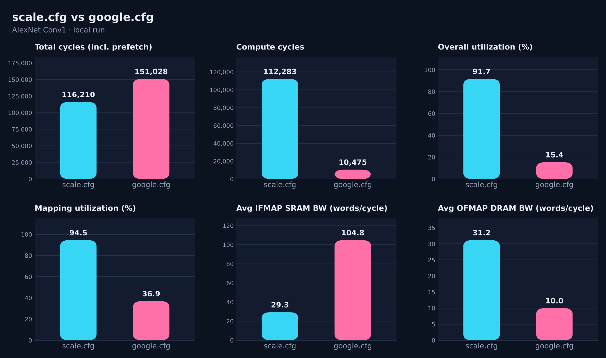
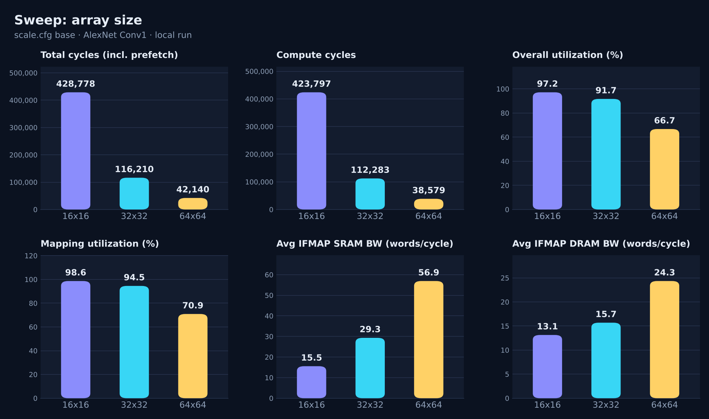
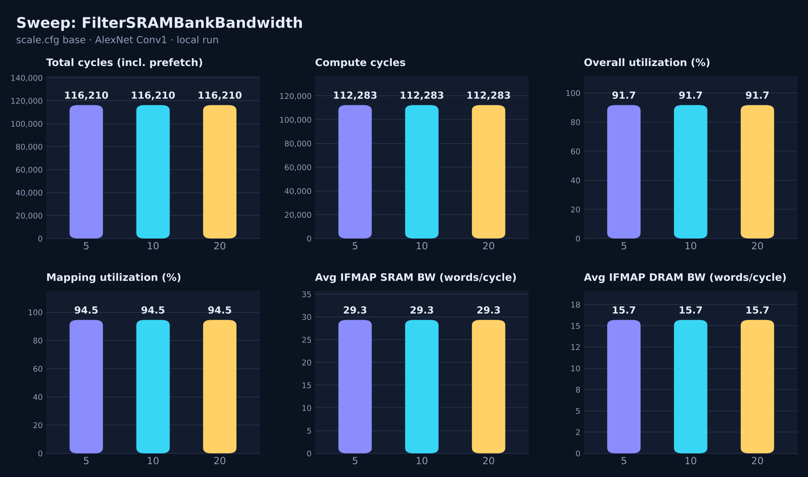
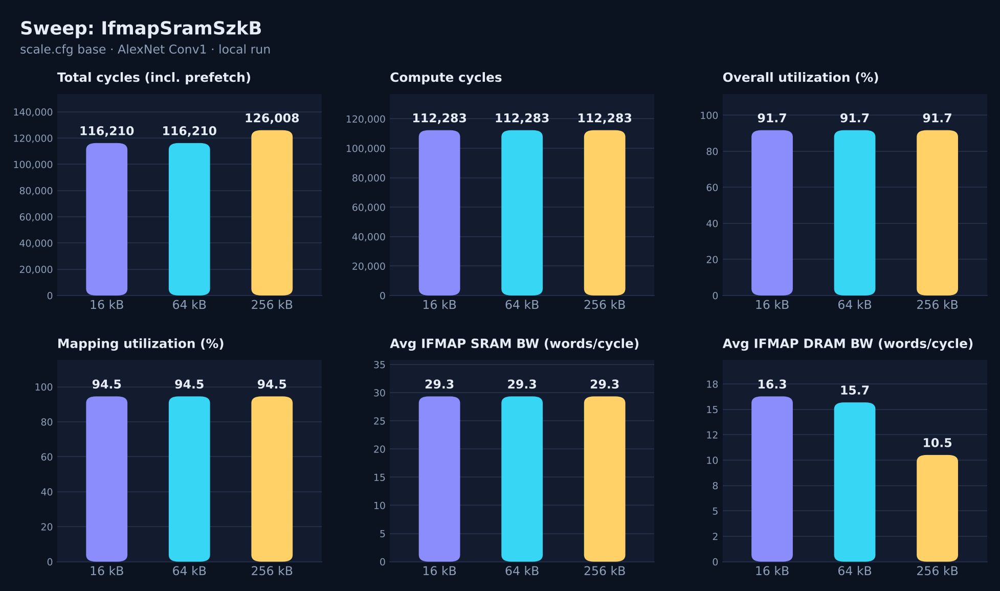

# Lab 4: ScaleSim

10/23/26 | Noa Schwartz

Lab instructions: [Simulators Part I, ScaleSim (Google Doc)](https://docs.google.com/document/d/1JAuO83rMpbEedpgGhyGss4F845B7vBj17Onmb2BT8qY/edit?usp=sharing)

Code and data: [github.com/noas-ark/cs2470-adv-comp-architecture/tree/main/lab4-scalesim](https://github.com/noas-ark/cs2470-adv-comp-architecture/tree/main/lab4-scalesim)

## Part I: Running the simulator

The base run takes 116,210 cycles (clock ticks the chip needs to finish the run) at 91.68% utilization, with no stalls (stall = cycles the array waited on memory to deliver data mid-run). Simulates 1 AlexNet layer on a 32x32 grid of MAC units.

| Metric | Value |
| --- | --- |
| Total cycles (incl. prefetch) | 116,210 |
| Compute cycles | 112,283 |
| Stall cycles (waiting on memory) | 0 |
| Overall utilization (share of unit-cycles doing useful MACs) | 91.68% |
| Mapping efficiency (how well the layer’s shape fills the grid) | 94.53% |
| Avg IFMAP SRAM BW (words/cycle) | 29.339 |
| Avg Filter SRAM BW (words/cycle) | 0.310 |
| Avg OFMAP SRAM BW (words/cycle) | 31.036 |
| Avg IFMAP DRAM BW (words/cycle) | 15.687 |
| Avg Filter DRAM BW (words/cycle) | 0.328 |
| Avg OFMAP DRAM BW (words/cycle) | 31.161 |

How the numbers tie to the layer:

- The layer has 55x55 = 3,025 output pixels, a filter window of 11x11x3 = 363 and 96 filters, about 105 million MACs.
- Mapping efficiency is geometry. The 363-long window needs 12 passes over the 32 rows, and the last pass fills only 11 rows. The 96 filters fill 3 groups of 32 columns exactly. Useful slots are 363x96 = 34,848 of 36,864, which is 94.53%.
- Total minus compute cycles is about 3,900 cycles of initial operand loading before compute starts.
- Filters are read from DRAM 1 time (34,848 words). Inputs are read from DRAM about 1.8 million times for a 150,528 word image, so the 64 kB input buffer cannot hold it and data is re-fetched. Outputs are written about 3.48 million times because each of the 12 passes writes partial sums
- IFMAP is the input, Filter is the weights, OFMAP is the output.

  ### 

The `results/` folder holds `COMPUTE_REPORT.csv`, `BANDWIDTH_REPORT.csv`, `DETAILED_ACCESS_REPORT.csv`, `TIME_REPORT.csv` and per-cycle address traces under `layer0/`.

- **Compute report (****`COMPUTE_REPORT.csv`****):** the cycle and utilization lines from above.
- **Bandwidth report (****`BANDWIDTH_REPORT.csv`****):** the six bandwidth lines from above.
- **Detailed access report (****`DETAILED_ACCESS_REPORT.csv`****):** for each memory (SRAM and DRAM, for input, filter and output), the first cycle it was used, the last cycle, and the total number of reads or writes. “Access” just means one read or write of the memory.

## Part II: How the simulator works

See`scalesim/single_layer_sim.py`.

- **What is the name of the function used to get the operand matrices for the filter?** `get_filter_matrix()` on the operand matrix object, called in `run()` as `_, filter_op_mat = self.op_mat_obj.get_filter_matrix()`.
- **What is the default word size?**\
1 byte (`word_size = 1`, with a comment that it could move into the config file).
- **What is the formula used to calculate BW for DRAM access?**\
Words moved divided by the operand's active DRAM cycles, for example `avg_ifmap_dram_bw = ifmap_dram_reads / (ifmap_dram_stop_cycle - ifmap_dram_start_cycle + 1)`, and the same for filter reads and ofmap writes.

## Exercise I: google.cfg vs scale.cfg

TLDR: the differences that matter are the array, buffer sizes, dataflow and memory interface. google.cfg is built for a large datacenter workload: a large array with large on-chip memory. scale.cfg is built to be small and cheap: a small array with small buffers. A bigger array does more math per cycle, but only if the layer has enough parallel work to fill it. Bigger buffers mean fewer trips to DRAM, which is slower and costs more energy. The dataflow decides which value stays put inside each MAC unit (weights in weight stationary, partial sums in output stationary), and so decides which data gets re-read and which gets written out repeatedly. The interface setting decides whether memory is assumed to keep up (CALC) or has a real speed limit (USER), which can make loading and writing dominate the total time.

Note (more for myself) - google.cfg is modeled on Google’s TPU v1. scale.cfg is not a real chip. It is SCALE-Sim’s own default example: a 32x32 array, 64 kB buffers and weight stationary dataflow.

| Setting | scale.cfg | google.cfg | Intuition on how it might affect output |
| --- | --- | --- | --- |
| Array size | 32x32 | 256x256 | 64x more MAC units, so the math should finish far faster. But each column takes 1 filter and this layer has only 96, so many columns will sit idle. Expect fewer compute cycles but lower utilization, and a higher data demand per cycle because more rows need feeding. |
| IFMAP SRAM (kB) | 64 | 6144 | A bigger buffer can keep input data on chip and reuse it instead of re-fetching it from DRAM, so expect fewer DRAM reads. The cost is that it has to be filled before compute can start. |
| Filter SRAM (kB) | 64 | 6144 | Room to hold all the weights on chip. Weights are a small share of the traffic in this layer, so expect this to matter less than the input buffer. |
| OFMAP SRAM (kB) | 64 | 2048 | A larger output buffer. Its effect cannot be separated from the dataflow change in this comparison (see the next row). |
| Dataflow | weight stationary (ws) | output stationary (os) | Decides what stays in each unit. Weight stationary writes partial sums back after every pass over the filter window, output stationary accumulates each output in place. Expect far fewer output writes to DRAM with output stationary, but the output buffer size also changed, so the drop cannot be credited to one of them. |
| Read / write request buffer | 32 / 32 | 512 / 512 | Request buffers hold memory requests waiting to be served, so bigger buffers mean longer queues to memory. Not isolated by this comparison, so I make no claim about their effect. |
| MemoryBanks | 1 | not set | Not isolated by this comparison, so I make no claim about its effect. |
| InterfaceBandwidth | CALC | USER | USER fixes DRAM bandwidth at the number in the config (10 words/cycle), so the fast array can end up waiting on memory instead of on math. Expect extra cycles loading inputs before compute and writing outputs after it, which can cancel out the faster compute. |

Simulator output for 6 metrics (AlexNet Conv1):

| Metric | What the results show |
| --- | --- |
| Total cycles (incl. prefetch) | google.cfg has the bigger workforce and computes fast, but InterfaceBandwidth changed from CALC to USER, which caps DRAM at 10 words/cycle. It waits about 111,500 cycles for inputs to arrive and spends about 29,000 sending outputs out, so faster work still means a longer total. |
| Compute cycles | 64x more workers, but extra workers only help if there is work for them. Each column handles 1 filter and this layer has only 96, so 160 of the 256 columns have nothing to do. That is why cycles fall 10.7x, not 64x. |
| Overall utilization | The same work is spread over many more MAC units, so each unit is busy a smaller share of the time. About 105 million MACs over 65,536 units and 10,475 cycles works out to 15.4% on google.cfg, against 91.7% on scale.cfg, where the units almost always have something to compute. |
| Mapping utilization | How much of the array holds useful work in each pass, given the layer's shape. scale.cfg: the 363-long filter window needs 12 passes of 32 rows and the last pass fills only 11, so 94.5%. google.cfg: only 96 of 256 columns get a filter (37.5%), times about 98% row use, so 36.9%. |
| Avg IFMAP SRAM BW (words/cycle) | How many input words the array must be fed every cycle. 256 rows each want a new input per cycle and the work finishes in about 10x fewer cycles, so demand goes up. Weight stationary also reads the inputs again for each group of 32 filters (3 times, 3.3M reads), while output stationary reads them 1 time (1.1M reads). |
| Avg OFMAP DRAM BW (words/cycle) | How many output words per cycle go out to DRAM. On google.cfg the DRAM interface is capped at 10 words/cycle and the measured value is exactly 10.00, so outputs are limited by memory, not by compute. On scale.cfg no cap is set (CALC), so the number is just what the layer would need. |

## Exercise II: Design space sweeps

Sweep setup. Note the base config appears in each sweep

| Parameter | Values | What we're testing |
| --- | --- | --- |
| Array size | 16x16, 32x32, 64x64 | Does more compute speed things up? It should help only until the 96 filters stop filling the columns. |
| FilterSRAMBankBandwidth | 5, 10, 20 | Does faster filter-buffer access help? |
| IfmapSramSzkB | 16, 64, 256 | Does a bigger input buffer reduce trips to DRAM? |

I changed last panel to IFMAP DRAM BW since it is the metric an input buffer size sweep should change. It's the average number of input words moved from DRAM into the input buffer each cycle, over the period when the input was being fetched. The other metrics barely react to buffer size.

Why? The input buffer (IFMAP SRAM) sits between DRAM and the array. When it is too small, the simulator has to fetch the same input data from DRAM again later. A bigger buffer keeps more of it on chip, so fewer words come from DRAM and the DRAM bandwidth falls. In the results it goes 16.3, 15.7, 10.5 words/cycle for 16, 64 and 256 kB.

### Array size

Compute cycles fall from 423,797 (16x16) to 112,283 (32x32) to 38,579 (64x64). Each step multiplies the MAC units by 4 but cuts cycles by only 3.8x, then 2.9x. Overall utilization drops from 97.2% to 91.7% to 66.7%, and the cause is mapping utilization (98.6%, 94.5%, 70.9%). The layer has 96 filters, so 64 columns need 2 passes and the second pass is half empty (96 of 128 column slots used, 75%). Bigger arrays also need more data per cycle: avg IFMAP SRAM BW goes 15.6, 29.3, 56.9 words/cycle. The 64x64 array is fastest, but each added MAC unit does less useful work.

### FilterSRAMBankBandwidth

All 6 metrics are identical at 5, 10 and 20. With `InterfaceBandwidth: CALC`, `single_layer_sim.py` hardcodes the filter backing bandwidth to 10 and ignores this setting. The extra runs in USER mode (10, 20, 40) also gave the same cycle counts as each other (449,664 total, 329,707 stall cycles, 23.3% utilization), because the 10 words/cycle DRAM interface is the limit, not the filter bank bandwidth. In this layer the filters are only 34,848 words, so there is little filter traffic for the setting to speed up.

### IfmapSramSzkB

Compute cycles, utilization and avg IFMAP SRAM BW do not change, since the array does the same work. Avg IFMAP DRAM BW falls from 16.3 to 15.7 to 10.5 words/cycle, and total IFMAP DRAM reads fall from 1,830,894 (16 kB) to 1,805,023 (64 kB) to 1,248,068 (256 kB), a 32% drop at 256 kB. But total cycles rise from 116,210 to 126,008 (+8.4%) at 256 kB, because a larger buffer takes longer to fill before compute starts. In this setup the extra DRAM savings are not worth the longer startup.

### Takeaway

TLDR Array size is the config/param that matters most for speed, with diminishing returns once the array is wider than the 96 filters can fill. Input buffer size trades DRAM traffic against startup time. Filter bandwidth does nothing for this layer.

This is because the lab simulates only AlexNet’s first conv layer (Conv1), which has 96 filters. AlexNet has 5 conv layers, and the later ones have more filters: Conv1: 96, Conv2: 256, Conv3: 384, Conv4: 384, Conv5: 256. Each array column takes 1 filter, the number of filters is how many columns have work. Conv1 with 96 filters leaves a 256-wide array mostly idle (160 columns empty). Conv2 with 256 filters would fill all 256 columns in a single pass. Conv3 and Conv4 with 384 would need 2 passes, filling all columns in 1st pass and 128 of 256 in the second.

So google.cfg’s 15.4% utilization is partly a result of testing it on a small layer. On the later layers it would likely look much better. This is also why a real chip is designed for the whole network, not one layer.
