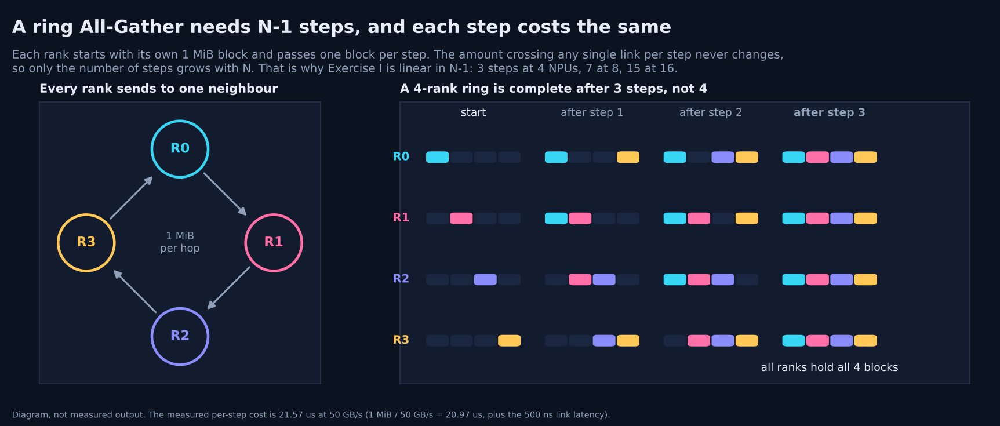
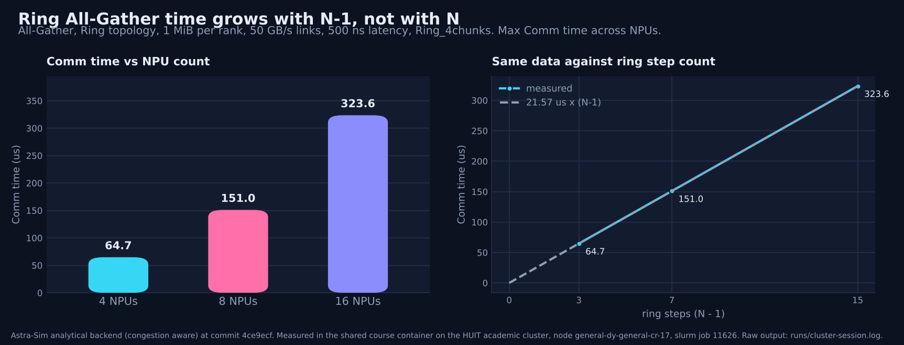
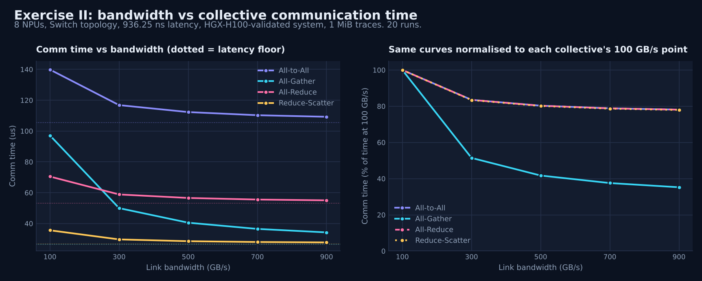

# Lab 5: Simulators Part II (Astra-Sim)

CS2470 Advanced Computer Architecture, Fall 2026 · @noa · Nov 16, 2026

Lab instructions: [Simulators Part II, Astra-Sim (Google Doc)](https://docs.google.com/document/d/1ax36L7ZgWKiysm1iY2KLCzsGJ7xxu8yGjIKTo4PFKz0/edit?usp=sharing)

Code and data: [github.com/noas-ark/cs2470-adv-comp-architecture/tree/main/lab5-astrasim](https://github.com/noas-ark/cs2470-adv-comp-architecture/tree/main/lab5-astrasim)

Raw simulator output from the cluster run: [`runs/cluster-session.log`](runs/cluster-session.log)

We're trying to figure out 2 questions about running collectives across many GPUs:

1. When you add GPUs to a collective, what happens to the time it takes?
2. When you make the links between them faster, what happens?

Both matter because in distributed training the collective is the part that does not get faster when you buy more compute.

## Background (mostly for me to make sure I understood)

### What a collective is

A **collective** is a communication operation that every rank in a job takes part in together. A **rank** (Astra-Sim calls it an NPU) is 1 GPU. Training needs these because the model is split across GPUs, so after every step the GPUs have to reconcile what they each computed.

The 4 in this lab:

- **All-Gather:** every rank has a piece, and every rank ends up with all the pieces.
- **Reduce-Scatter:** every rank has a full array, they get summed elementwise, and each rank ends up with 1/N of the result.
- **All-Reduce:** sum across all ranks, every rank ends up with the full sum. It is a Reduce-Scatter followed by an All-Gather, which is why it costs about twice either one.
- **All-to-All:** every rank sends a different piece to every other rank. A transpose across the ranks.

### How a ring does it

A **ring** arranges the ranks in a circle, each sending only to its 1 neighbour. A **switch** lets any rank reach any other through shared hardware. Both appear in this lab: Exercise I is a Ring, Exercise II is a Switch.

Note - rings takes **N-1 steps**, and the amount crossing any single link per step does not depend on N:



### Chunking

The system config splits each collective into **chunks** that pipeline through the network (`preferred-dataset-splits: 4` in `Ring_4chunks.json`). Chunking matters more than I expected: it turns up again in Exercise II as the reason the latency floor is the size it is.

### What Astra-Sim is actually simulating

3 pieces, and it is worth being clear which is which:

- The **workload** says what each rank does, as a Chakra trace. In this lab each trace is 1 collective and no compute at all.
- The **network** says what the hardware is: topology, rank count, link bandwidth, link latency.
- The **system** says which algorithm implements each collective, and how it is chunked.

The analytical backend then computes how long that takes with a closed-form model rather than simulating individual packets. That is why it runs in under a second, and why the answer is deterministic.

### Time in the simulator

Astra-Sim reports **ticks**, and for this backend 1 tick = 1 ns, so microseconds = ticks / 1000. This is **simulated** time: what the modeled hardware would take. It has nothing to do with how long the simulator took to run on the cluster, which is well under a second either way.

## Setup

- **Cluster:** HUIT academic cluster, interactive CPU session on node `general-dy-general-cr-17`, slurm job 11626, requested with `srun -p general -c 8 --mem=16G --pty bash`. CPU only, no GPU involved, even though the thing being modeled is distributed GPU training
- **Simulator:** [astra-sim/astra-sim](https://github.com/astra-sim/astra-sim) at the revision the lab pins, `4ce9ecfe746a3ee5fe47559a11d91644d641fa7f`, built from source with submodules inside the shared course container (`source ~/169291/astra-sim/activate.sh`, then `astra-sim-shell`)
- **Backend:** analytical, congestion aware (`AstraSim_Analytical_Congestion_Aware`)
- **Inputs:** the stock files shipped in `examples/`. The only thing I edit is a copy of the network YAML, which is what Exercise II sweeps
- **Driver:** `code/run_sweeps.py` runs all 24 simulations and writes `results.csv`; `code/plot_sweeps.py` and `code/plot_ring.py` draw the figures. `runs/cluster-session.log` is the raw output of the cluster session, and `runs/*.log` the per-run logs
- **Which number I report:** Astra-Sim prints a Wall time and a Comm time per NPU. Per the lab I take the **max across NPUs**, never the sum. Every NPU reported the identical value in all 24 runs, so max and min coincide here. The `uniq -c` counts in the session log are what show that (`16 Comm time: 323560` means all 16 agreed)

notes:

**The results do not depend on the machine.** I ran the full sweep twice: once on a separate machine with its own build of the same pinned commit, and once in the course container on the cluster. All 41 runs (24 for the exercises, 17 probes) returned identical tick counts, down to the digit; the cluster side is recorded in `cluster-verification.csv` and `runs/cluster-session.log`. The analytical backend has no timing-dependent behaviour, so what comes out is a function of the inputs and the revision, not of the host. Worth knowing before spending a compute allocation on a re-run.

**Note:** inside the container `$HOME` is `/home/nos673`, while the real home is `/shared/home/nos673`. Anything built from `$HOME` fails with "No such file or directory" even though the same path works outside. I used absolute `/shared/home/...` paths instead. The container preserves your working directory, so `pwd` is the quick way to find out where you actually are.

## Part II: Running the simulator

**Q. Record the printed "Wall time" and "Comm time" in microseconds.**

| Metric | Ticks | Microseconds |
| --- | --- | --- |
| Wall time | 323,560 | 323.560 |
| Comm time | 323,560 | 323.560 |
| Exposed communication | 323,560 | 323.560 |

All 16 NPUs report the same 3 numbers.

**Q. Why are they equal for this workload?**

**Because this workload is nothing but communication.** The Chakra trace for each rank holds exactly 1 node, a collective comm op, and no compute node at all (I decoded it, see Part III). Wall time is the total simulated time the NPU was busy and Comm time is the part of it spent communicating, so when there is no compute to run there is nothing for the other category to hold and nothing for the collective to overlap with. The log's third number says the same thing from the other side: all 323,560 cycles are *exposed* communication, meaning none of it was hidden behind compute.

The practical point is that this is the pathological case. In a real training step you would want Comm time well below Wall time, because that gap is the communication you managed to overlap with useful math.

## Part III: Understanding how the simulator works

4 input directories, 1 per concern, all selected by the run script:

| Directory | Format | What it specifies |
| --- | --- | --- |
| `workload/` | binary Chakra execution traces, `.et`, 1 file per NPU | what each rank actually does |
| `network/` | YAML, for the analytical backend | topology, NPU count, link bandwidth, link latency |
| `system/` | JSON | scheduling policy, chunking, and which algorithm implements each collective |
| `remote_memory/` | JSON | memory expansion model, here `NO_MEMORY_EXPANSION` |

notes:

**The workload traces are tiny.** Each `.et` is 81 to 85 bytes. They are binary protobuf, so they cannot be edited as text, but they can be read with the Chakra schema that the build generates (`extern/graph_frontend/chakra/schema/protobuf/et_def_pb2.py`). Decoding rank 0 of each 8 NPU microbenchmark gives 1 node each:

| Trace | Node type | `comm_size` |
| --- | --- | --- |
| `all_gather/8npus_1MB` | comm coll | 1,048,576 |
| `all_reduce/8npus_1MB` | comm coll | 1,048,576 |
| `all_to_all/8npus_1MB` | comm coll | 1,048,576 |
| `reduce_scatter/8npus_1MB` | comm coll | 1,048,576 |

So all 4 say 1 MiB, which is exactly the lab's warning: the same `comm_size` means different amounts of traffic depending on the collective. Exercise II turns out to measure that difference directly.

*Method:* decoded with the generated `et_def_pb2.py` and protobuf's varint length-delimited reader, reading the `GlobalMetadata` message first and then each `Node`.

**The network file is the only knob with a real number in it.** It is 4 lines, which is why it is the thing to sweep:

```yaml
topology: [ Switch ]
npus_count: [ 8 ]
bandwidth: [ 400.0 ]  # GB/s
latency: [ 936.25 ]  # ns
```

**The system file picks the algorithm, not the collective.** `Ring_4chunks.json` and `HGX-H100-validated.json` both set every `*-implementation` to `ring`. The collective itself comes from the workload trace. The 2 differ in `active-chunks-per-dimension` (1 vs 2) and `local-mem-bw` (1600 vs 3350). `preferred-dataset-splits: 4` is the 4 chunks in the Ring config's name, and it shows up in the Exercise II results in a way I did not expect.

## Exercise I: All-Gather scaling with NPU count

**Q. Create a graph that shows how All-Gather communication time scales while changing the number of NPUs. Sweep [4, 8, 16].**

**Step 1, hold everything else fixed.** Bandwidth 50 GB/s, latency 500 ns, `Ring_4chunks.json`, and 1 MiB of input *per rank*. For each N the matching network file (`Ring_Nnpus.yml`) and the matching workload prefix.

**Step 2, results.**

| NPUs | Comm time (us) | Ring steps (N-1) | Time per step (us) | Total data gathered |
| --- | --- | --- | --- | --- |
| 4 | 64.744 | 3 | 21.581 | 4 MiB |
| 8 | 151.016 | 7 | 21.574 | 8 MiB |
| 16 | 323.560 | 15 | 21.571 | 16 MiB |



**Q. Explain the communication-time trend you observe.**

**The trend is linear in N-1, not in N.** This is cleaner than I expected. The slope between 4 and 8 NPUs is 21.568 us per step and the slope between 8 and 16 is also 21.568 us per step, to 3 decimals. Fitting a line through all 3 points gives an intercept of 0.04 us, which is 40 ns, basically zero. So:

```
comm time (us) = 21.568 x (N - 1)
```

The measured ratios say the same thing: 151.016 / 64.744 = 2.3325 against a predicted 7/3 = 2.3333, and 323.560 / 64.744 = 4.9975 against a predicted 15/3 = 5.

**Why.** The diagram in the Background section is the whole answer: a ring All-Gather takes N-1 steps, and on each step every rank passes 1 block to its neighbour, so the amount crossing any single link per step is fixed no matter how big the ring is. Only the number of steps grows. Checking the per step cost against first principles: 1 MiB at 50 GB/s is 1,048,576 / 50e9 = 20.97 us, plus the 500 ns link latency gives 21.47 us. Measured is 21.57 us, so roughly 0.1 us per step is chunking and endpoint overhead that the simple model leaves out.

*Method:* the per step figure is just comm time divided by N-1. The slope is the difference between consecutive points divided by the difference in step count, computed in `code/plot_sweeps.py`; both intervals agreeing to 3 decimals is what makes the straight line claim safe rather than eyeballed.

** time grows with N but the data gathered also grows with N, so cost per byte delivered is nearly flat. That is the sense in which ring All-Gather is bandwidth efficient. What it is not is latency efficient, because N-1 sequential steps means the ring gets deeper every time you add a GPU, and each step is a dependency, not something you can parallelize away. A 16 NPU ring spends 323 us moving 1 MiB per rank. That is the argument for hierarchical or tree collectives once N gets large, and it is why real multi node systems do not run 1 flat ring across every GPU.

## Exercise II: Bandwidth's impact on different collectives

**Q. Sweep the network bandwidth over [100, 300, 500, 700, 900] GB/s for each of All-Gather, All-Reduce, All-to-All and Reduce-Scatter. Plot bandwidth against simulated Comm time, 1 curve per collective.**

**Step 1, hold everything else fixed.** 8 NPUs, Switch topology, latency 936.25 ns, `HGX-H100-validated.json`, the supplied 1 MiB traces. Only the `bandwidth` field of a copy of the network YAML changes. 20 runs.

| Bandwidth (GB/s) | All-Gather | All-Reduce | All-to-All | Reduce-Scatter |
| --- | --- | --- | --- | --- |
| 100 | 97.157 | 70.479 | 139.877 | 35.591 |
| 300 | 49.973 | 58.851 | 116.825 | 29.675 |
| 500 | 40.520 | 56.571 | 112.305 | 28.515 |
| 700 | 36.488 | 55.545 | 110.271 | 27.993 |
| 900 | 34.227 | 55.031 | 109.253 | 27.731 |



In the right hand panel All-to-All, All-Reduce and Reduce-Scatter sit almost exactly on top of each other, which is the finding, not a plotting mistake. They all shed about 22% while All-Gather sheds 65%.

**Q. Which collective benefits most from added bandwidth?**

**All-Gather, by a wide margin.** Going from 100 to 900 GB/s:

| Collective | 100 GB/s | 900 GB/s | Saved | Saved % |
| --- | --- | --- | --- | --- |
| All-Gather | 97.157 | 34.227 | 62.93 us | 64.8% |
| All-to-All | 139.877 | 109.253 | 30.62 us | 21.9% |
| All-Reduce | 70.479 | 55.031 | 15.45 us | 21.9% |
| Reduce-Scatter | 35.591 | 27.731 | 7.86 us | 22.1% |

**Step 2, split each curve into the part bandwidth touches and the part it does not.** All 20 points fit `comm = A / BW + B` almost perfectly, with a worst case residual of 0.05 us, which is 0.04%:

| Collective | A (us x GB/s) | A relative to Reduce-Scatter | Floor B (us) |
| --- | --- | --- | --- |
| All-Gather | 7,079 | 8.00x | 26.37 |
| All-to-All | 3,449 | 3.90x | 105.38 |
| All-Reduce | 1,740 | 1.97x | 53.08 |
| Reduce-Scatter | 885 | 1.00x | 26.74 |

*Method:* A and B are a least squares fit of comm time against 1/BW over all 5 points per collective, not a 2 point solve, so a bad fit would show up as a large residual. It does not: the worst point in the whole table is off by 0.05 us.

The A column is a data volume ranking, and for 3 of the 4 it lands on the textbook number exactly. With N = 8:

- **Reduce-Scatter** takes 1 MiB total and leaves each rank with 1/N of it, so each rank moves (N-1)/N = 0.875 MiB. Call that 1x.
- **All-Reduce** is a Reduce-Scatter followed by an All-Gather over the same buffer, 2(N-1)/N = 1.75 MiB, so **2x**. Measured 1.97x.
- **All-Gather**'s `comm_size` is per rank input, not total, so every rank has to receive the other N-1 ranks' megabyte, 7 MiB. That is **8x** Reduce-Scatter's 0.875 MiB. Measured 8.00x.

All-Gather therefore moves the most bytes of the 4 while also having the lowest fixed floor, so it is the one with the most to gain from a fatter link. All-to-All lands at 3.90x, close to 4x, which I could not derive cleanly; the ring based All-to-All in this system config does roughly 4 times Reduce-Scatter's work in both bytes and steps, and its floor behaves the same way (see below), so the 2 are consistent, but I am reporting that as measured rather than derived.

1 consequence visible in the left panel: All-Gather starts slower than All-Reduce at 100 GB/s (97 vs 70 us) and ends faster at 900 (34 vs 55). I measured the crossover at 200 GB/s, where both land on 61.75 us. Which collective is "expensive" is not a fixed property, it depends on the link you run it over.

**Q. Why might the curves flatten?**

**Because the bandwidth term is hyperbolic and it is sitting on top of a floor that bandwidth cannot touch.** A/BW falls off fast early and barely moves later. For All-Gather, each extra 200 GB/s buys:

| Step | Comm time | Change |
| --- | --- | --- |
| 100 -> 300 | 97.157 -> 49.973 | -47.18 us (-48.6%) |
| 300 -> 500 | 49.973 -> 40.520 | -9.45 us (-18.9%) |
| 500 -> 700 | 40.520 -> 36.488 | -4.03 us (-10.0%) |
| 700 -> 900 | 36.488 -> 34.227 | -2.26 us (-6.2%) |

The last 200 GB/s is worth 5% of what the first 200 was worth, for the same hardware cost.

**Step 3, find out what the floor is made of.** I ran 4 extra simulations outside the required sweep. Setting bandwidth to 1,000,000 GB/s, effectively infinite, so that only the floor is left:

| Collective | Comm time at infinite BW | Fitted floor B | Floor / 936.25 ns |
| --- | --- | --- | --- |
| Reduce-Scatter | 26.746 us | 26.74 | 28.6 |
| All-Gather | 26.368 us | 26.37 | 28.2 |
| All-Reduce | 53.094 us | 53.08 | 56.7 |
| All-to-All | 105.412 us | 105.38 | 112.6 |

2 things fall out. The measured asymptotes match the fitted floors to within 0.03 us, so the fit was describing something real. And dividing by the link latency gives roughly **28, 28, 56, 112**, which is 1 : 1 : 2 : 4. 28 is exactly 7 ring steps x 4 chunks, the `preferred-dataset-splits: 4` from the system config. All-Reduce is 2x because it is a Reduce-Scatter plus an All-Gather, and All-to-All is 4x, the same factor that showed up in its bandwidth term.

To confirm the floor is link latency and not something else like local memory bandwidth, I reran All-Gather at 900 GB/s with latency set to 0:

| Config | Comm time |
| --- | --- |
| 900 GB/s, 936.25 ns latency | 34.227 us |
| 900 GB/s, 0 ns latency | 8.019 us |
| infinite BW, 936.25 ns latency | 26.426 us |
| infinite BW, 0 ns latency | 0.218 us |

Removing latency removes 26.2 us, which is the floor almost exactly, and removing both leaves 0.218 us of residual overhead. So the floor is serialized link latency: 28 hops that have to happen 1 after another because each ring step depends on the previous one. No amount of bandwidth removes a dependency chain.

## Takeaway

TLDR: both exercises are the same lesson from different directions. Collective communication cost splits into a bytes term that bandwidth fixes and a steps term that it cannot.

Exercise I holds bandwidth constant and grows the step count: time goes up linearly in N-1, exactly. Exercise II holds the step count constant and grows bandwidth: time falls as 1/BW onto a floor set by those steps. The floor is the number of serialized hops times the link latency, and that number comes out of the algorithm and the chunking, not the hardware.

So the design lever depends on which term dominates. For All-Gather at 100 GB/s, 73% of the time is bytes in flight and buying bandwidth is the right move. For All-to-All at 900 GB/s, 96% of the time is the latency floor and more bandwidth is close to wasted money; what helps there is a shallower algorithm or fewer chunks. The HGX baseline's real 400 GB/s sits on the bend for All-Gather: at that point the bytes term is 17.7 us of a 44.1 us total, so 40%.

Caveat on the numbers above the baseline: the lab notes these bandwidth variations are hypothetical and the HGX-H100 validation does not extend to every modified configuration, so the 900 GB/s points are the model's opinion rather than a validated prediction.
